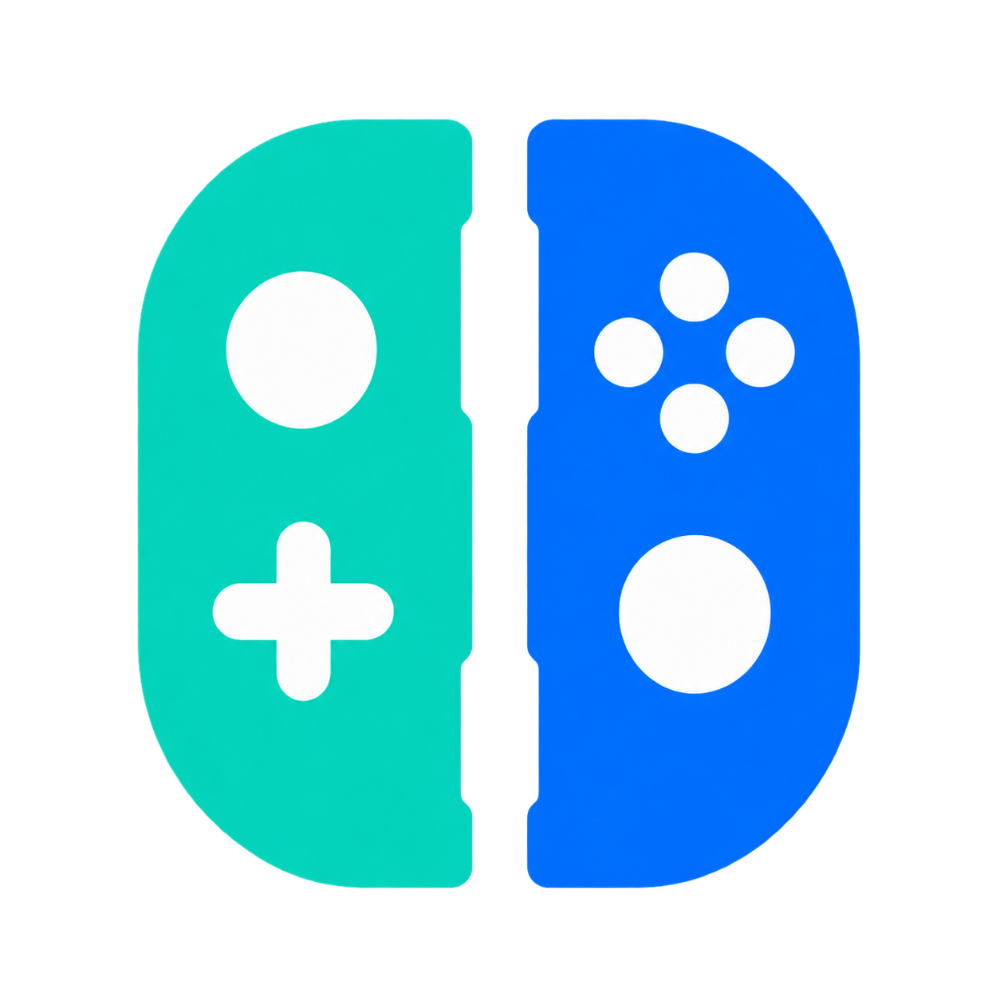

<!--
# SPDX-FileCopyrightText: Copyright 2025 Eden Emulator Project
# SPDX-License-Identifier: GPL-3.0-or-later

# SPDX-FileCopyrightText: 2018 yuzu Emulator Project
# SPDX-License-Identifier: GPL-2.0-or-later
-->
<!-- lang: en-GB -->

<div align="center">



# Nemyu

**A free and open-source Nintendo Switch 2 emulator, written in C++.**

[](https://gitlab.com/nemyu-emulator/nemyu/-/releases)
[](LICENSE.txt)
[](https://discord.gg/eglantine)

[Compatibility](#compatibility) · [Performance](#performance) · [Features](#features) ·
[Download](#download) · [Requirements](#system-requirements) · [Getting started](#getting-started) ·
[Building](#building-from-source) · [Contributing](#contributing) · [Licence](#licence)

</div>

Nemyu is an emulator for the Nintendo Switch 2. Its goal is to run every Switch 2 game accurately,
the way yuzu and Eden set out to do for the original Switch, and it keeps running Switch 1 games
through the emulation it inherits from Eden.

Nemyu is a fork of [Eglantine](https://github.com/Djihads80/Eglantine), which is derived from
[Eden](https://git.eden-emu.dev/eden-emu/eden), yuzu and Sudachi. It runs on Windows, with an
experimental Linux AppImage, and can be built from source on macOS. It is licensed under
GPL-3.0-or-later, and development happens on GitLab at
[nemyu-emulator/nemyu](https://gitlab.com/nemyu-emulator/nemyu).

> [!NOTE]
> Switch 2 emulation is at an early stage. A handful of games are playable, many reach their title
> screen or gameplay with serious problems, and most have not been tested. Expect bugs, and check
> the [compatibility](#compatibility) section before you report one.

## Compatibility

Nemyu has no full compatibility list yet. The table below covers the Switch 2 games we test regularly, as
of November 2026 on development builds, on the [test system](#performance) described below.
Nothing is claimed for games that are not listed.

| Status | Meaning |
| --- | --- |
| **Playable** | Gameplay works on our test route at or near full game speed. Minor problems may remain, and the game has not necessarily been played to the end. |
| **In-game** | Reaches gameplay, but with major graphical, audio or performance problems. |
| **Boots** | Starts and shows a title screen, intro or menu, but gameplay is not reached or not verified. |
| **Nothing** | Does not get past the first frames. |

### Nintendo Switch 2

| Game | Status | Notes |
| --- | --- | --- |
| Mario Kart World (version 1.8.0) | Playable | Races at about 36-38 fps with the game at about 97-98% of full speed. |
| Donkey Kong Bananza | Playable | About 30 fps on our test route; the game caps itself at 30 fps when the GPU is the limit. |
| The Legend of Zelda: Ocarina of Time (Switch 2) | In-game | The intro and cutscenes run at 60 fps and full speed; with the built-in Dynamic FPS patch, our test route averages about 37 fps at about 85% of full speed. Work in progress. |
| Pokémon Pokopia | Boots | Title screen at 60 fps; gameplay not verified yet. |
| Nintendo Switch 2 Welcome Tour | Boots | The opening movie and the title screen render correctly at 60 fps; the tour itself is not verified yet. |
| Yoshi and the Mysterious Book (demo) | Nothing | Does not get past the first frames yet. |

Splatoon Raiders has not been measured on our test system; players report that it runs, with
variable performance.

## Performance

These figures show where development stands, not what every PC will reach. They come from one
mid-range gaming laptop, so a desktop with a stronger CPU or GPU will usually do better and a
laptop held to a low power limit will do worse.

| Test system | |
| --- | --- |
| GPU | NVIDIA GeForce RTX 3050 6 GB Laptop GPU |
| CPU | Intel Core i5-13450HX |
| Memory | 16 GB or more |
| Operating system | Windows, on mains power |
| Graphics backend | Vulkan |
| Build | Nemyu 0.1.6 (MSVC) |

**Method.** Every run starts with a warm shader cache, so pipelines built in earlier runs do not
add stutter. Mario Kart World is measured with the race benchmark in
[tools/nx2/mkw_bench](tools/nx2/mkw_bench/README.md), which drives a Grand Prix race through
`nemyu-cli` with a key script and averages the frame times the emulator logs; run-to-run noise is
about 1.5 ms per frame. Other games are measured on the same system on a fixed route or screen.

**Game speed** is how much game time passes per real second: at 100% the game runs as fast as on
the console. A game can stay close to full speed below 60 fps when it advances more time per
frame, as Mario Kart World does with the default **Dynamic** frame rate setting.

| Game | Scene | Frame rate | Frame time | Game speed |
| --- | --- | --- | --- | --- |
| Mario Kart World | Race | 36-38 fps | about 26-27 ms | about 97-98% |
| Donkey Kong Bananza | Test route | about 30 fps (game cap) | - | - |
| Zelda: Ocarina of Time (Switch 2) | Intro and cutscenes | 60 fps | - | 100% |
| Zelda: Ocarina of Time (Switch 2) | Test route | about 37 fps (average) | about 26-27 ms | about 85% |
| Pokémon Pokopia | Title screen | 60 fps | - | - |

Donkey Kong Bananza runs about 15% faster on its test route than in Nemyu 0.1.4.
Ocarina of Time gameplay is the main performance target at the moment: a stand-in replaces the
game's upscaler network, and the GPU thread is being optimised.

## Features

### Switch 2 support

- **Game formats**: NUP containers (`.nup`), NSP and XCI files that hold a Switch 2 game, and
  extracted dumps (`exefs` and `romfs` folders). See [Switch 2 games](#switch-2-games).
- **GPU emulation**: the Switch 2 GPU's Ampere command classes and the command streams that NVN, the
  console's graphics API, produces are emulated and drawn with Vulkan, including mesh shader draws.
- **DLSS**: **Use the game's own DLSS** runs a game's DLSS network, translated for your GPU; only
  Fire Emblem: Fortune's Weave is known to use one. Turned off, a cheaper plain upscale stands in,
  sharpened with **RCAS sharpness**, and a status line shows which one is in use. **Use NVIDIA DLSS
  in place of a game's DLSS** (experimental, GeForce RTX) only appears in builds made with the
  `ENABLE_NVIDIA_DLSS` CMake option, and needs NVIDIA's Streamline and DLSS files, which you provide
  yourself; Nemyu does not ship them.
- **Automatic settings**: Switch 2 games always get 12 GB of console memory and adjust a few
  graphics settings on their own; the list is shown on the **Switch 2** settings page.
- **Controllers**: the input settings and the controller applet use the Joy-Con 2, TV mode and
  Handheld mode names and draw the Joy-Con 2 with its real button layout. In games that use Joy-Con 2
  mouse mode, the PC mouse acts as player 1's right Joy-Con 2, with left and right click as ZR and R.
- **Amiibo**: **File > Load/Remove Amiibo...** accepts an amiibo before the game asks for one and
  scans it as soon as the game does. v3 amiibo dumps (2048 bytes) load, and the Switch 2 amiibo
  commands are answered (the extended application area is not read yet).

### Performance

- **GPU thread split**: for Switch 2 games, the GPU thread is split in two, one thread reading
  command lists and the other running the GPU methods and recording draws.
- **Pipeline preload at boot** (**Graphics > Advanced**): **All cached pipelines** builds every
  cached pipeline while the game loads, for a longer boot and less stutter later.
- **Frame generation** (Vulkan, **Graphics > Frame Generation**, off by default): the built-in
  optical flow or Lossless Scaling, with a 2x to 4x multiplier and a target frame rate. Lossless
  Scaling needs `Lossless.dll` from your own copy, placed in the `lossless` subfolder of the
  [data folder](#data-folder); it is not included with Nemyu.
- **Mario Kart World frame rate** (**Switch 2**): **Dynamic**, the default, keeps the game closer to
  full speed when it renders below 60 fps; **Lock 30 FPS** is there for slower PCs.

### Usability

- **Organised settings**: options are grouped by topic and each has a tooltip with what it does and
  a practical tip. Expert groups and the **Graphics > Fixes** tab stay hidden until **Show advanced
  settings** is ticked, unless one of their settings was changed.
- **Advanced Switches** (**Switch 2**, shown with **Show advanced settings**): a searchable table of
  the `EDEN_NX2_*` switches, with a tooltip each and **Import...**/**Export...**. Ticked switches are
  saved to `nx2_switches.txt` and apply after a restart.
- **Per-game properties** (right-click a game > **Configure Game**): a header with the game's cover,
  version, title ID, format and size; an **Add-Ons** tab that shows what each add-on is (update, DLC,
  mod, cheats, built-in patch); and a **Reset to Global** button per tab. Ocarina of Time has a
  built-in **Max Resolution** add-on that renders its 3D at full scale and a **Dynamic FPS** add-on
  that keeps the game at full speed below 60 fps, both on by default.
- **Box art** for games without an icon, downloaded once from the
  [Nemyu box art repository](https://gitlab.com/nemyu-emulator/boxart) (or Eden's, for games it
  lacks) and shown in the game list, on the loading and closing screens and in the game's
  properties. **Box Art URL** in **General > Interface** sets a different source.
- **Discord Rich Presence**, on by default, shows the game you are playing and its box art; it can
  be turned off in **General > Interface**.

### For developers

- **Race benchmark**: [tools/nx2/mkw_bench](tools/nx2/mkw_bench/README.md) measures repeatable
  in-race frame times in Mario Kart World with `nemyu-cli`.
- **Diagnostics**: the Advanced Switches table includes diagnostic switches (GPU profiling, traces,
  dumps and checks) next to the ones that change behaviour, each with its default, the games it
  matters for and its known downsides.

## Download

Builds are published on the [Releases page](https://gitlab.com/nemyu-emulator/nemyu/-/releases).

| Platform | Package |
| --- | --- |
| Windows (x86-64) | `nemyu-<tag>-windows-x86_64.zip`: extract it to any folder and run `nemyu.exe`. Built with MSVC; Qt, the Visual C++ runtime and the licence texts are included. |
| Linux (x86-64) | `nemyu-<tag>-linux-x86_64.AppImage` (experimental, new tag releases only): make it executable and run it. Requires glibc 2.39 or newer (Ubuntu 24.04), X11 or XWayland and suitable graphics drivers. |
| macOS | No prebuilt release; [build Nemyu from source](#building-from-source). |
| Android | No release. |

`nemyu-cli` is the command-line version; run it from a terminal (see
[Command Line](docs/user/CommandLine.md)). Vulkan is the default graphics backend, so keep your GPU
driver up to date.

## System requirements

| | Minimum | Recommended (our test system) |
| --- | --- | --- |
| Operating system | Windows 10 or 11, 64-bit (the Linux AppImage is experimental) | Windows 10 or 11, 64-bit |
| Processor | 64-bit CPU with several cores | Intel Core i5-13450HX or better |
| Graphics | GPU with Vulkan 1.3 and a current driver | NVIDIA GeForce RTX 3050 6 GB Laptop GPU or better |
| Memory | 16 GB of RAM plus a page file | 16 GB of RAM or more, with a system-managed page file |

- **Vulkan is required for Switch 2 games**; with OpenGL they crash at boot. Most testing is on
  NVIDIA; reports from AMD and Intel GPUs are welcome.
- **Memory**: Switch 2 games commit about 10 GB while they run. Nemyu warns when Windows has little
  virtual memory (RAM + page file) left as a game starts; if you see that warning, let Windows
  manage the page file size and restart.
- **Processor**: emulating the Switch 2 GPU is CPU-heavy, so laptops held to a low power limit
  (around 35 W) run noticeably slower than the same CPU on a desk.

## Getting started

Nemyu does not include keys, firmware or games. Dump them from a console and games you own.

1. Start Nemyu (`nemyu.exe` on Windows).
2. Install your keys with **Tools > Install Decryption Keys** and select your `prod.keys` file.
3. Install your firmware with **Tools > Install Firmware > From Folder** or **From ZIP**.
4. Double-click the empty game list and select the folder that holds your games.
5. Set up your controller in **Emulation > Configure... > Controls**.
6. Double-click a game to start it.

The [User Handbook](docs/user/README.md) covers settings, controllers, updates and DLC, mods, saves
and troubleshooting in more detail.

### Switch 2 games

Switch 2 games can be loaded in these forms:

- **NUP containers** (`.nup`): a single file that can hold the base game, its update and DLC. Nemyu
  boots the base game with the update from the same file applied, and takes the game's name, version
  and icon from the container. DLC in a NUP is not mounted yet.
- **NSP and XCI files** that hold a Switch 2 game, which are recognised as Switch 2.
- **Extracted dumps**: one folder per game, with the program in an `exefs` folder (the file named
  `main`) and the game data in a `romfs` folder next to it:

```text
Games/
  Mario Kart World/
    exefs/
      main
      ...
    romfs/
      ...
```

Add the folder that contains the games (`Games` above, which can also hold `.nup` files) to the
game list. To start a single game without adding it, use **File > Load File...** for a `.nup` file
or **File > Load Folder...** for the `exefs` folder of a dump, or run it from a terminal:

```powershell
nemyu-cli.exe -g "D:\Games\Mario Kart World\exefs\main"
```

Extracted dumps usually have no name or icon, so Nemyu names them from a bundled title list
([`dist/switch2_titles.json`](dist/switch2_titles.json)) and shows their box art instead.

### Data folder

Keys, firmware, saves, configuration and logs are kept in a folder named `nemyu`:

| System | Location |
| --- | --- |
| Windows | `%APPDATA%\nemyu` |
| Linux and macOS | `~/.local/share/nemyu` (data), `~/.config/nemyu` (configuration) and `~/.cache/nemyu` (cache), or the `nemyu` folders under `$XDG_DATA_HOME`, `$XDG_CONFIG_HOME` and `$XDG_CACHE_HOME` when they are set |

A folder named `user` makes the install portable: Nemyu then keeps everything in it. On Windows it
goes next to `nemyu.exe`; on Linux and macOS, Nemyu looks for it in the directory it is started
from. **File > Open Nemyu Folders** opens the data folder and its subfolders, including the `log`
folder (see [How to Access Logs](docs/user/HowToAccessLogs.md)).

Eden, Eglantine and earlier Nemyu builds kept their data in a folder named `eden`. If Nemyu finds
no `nemyu` folder when it starts, it copies your keys, firmware, saves and settings from the `eden`
folder once and leaves the original untouched.

## Help and bug reports

- Start with the [User Handbook](docs/user/README.md) and its
  [troubleshooting page](docs/user/Troubleshoot.md).
- Two common fixes: keep **Graphics > API** on Vulkan, and if the emulator closes by itself or warns
  about low virtual memory, enlarge the page file (Advanced system settings > Performance >
  Settings > Advanced > Virtual memory, "System managed") and restart.
- Report bugs, request features and ask questions in the
  [GitLab issue tracker](https://gitlab.com/nemyu-emulator/nemyu/-/issues). Search the existing
  issues first, then use the
  [Bug](https://gitlab.com/nemyu-emulator/nemyu/-/issues/new?issuable_template=Bug) or
  [Feature](https://gitlab.com/nemyu-emulator/nemyu/-/issues/new?issuable_template=Feature)
  template (the Bug template only for actual bugs).
- A bug report should include the build you used (the release tag, or the commit shown in
  **Help > About Nemyu**), the steps to reproduce the problem, your log file and your CPU, GPU and
  driver, RAM and operating system.

GitLab is the official place for Nemyu bug reports and support. The community channels of Eden and
Eglantine belong to those projects.

## Building from source

Nemyu builds with CMake on Windows, Linux and macOS. Install the [dependencies](docs/Deps.md) first,
then:

```sh
git clone https://gitlab.com/nemyu-emulator/nemyu.git
cd nemyu
cmake -S . -B build -G Ninja -DCMAKE_BUILD_TYPE=Release
cmake --build build
```

On Windows, load the Visual C++ environment in the same terminal before running CMake, with
`.\tools\windows\load-msvc-env.ps1`. The Windows releases are built with MSVC.

The programs are written to `build/bin`: `nemyu` (the Qt interface) and `nemyu-cli` (the
command-line version), with `.exe` on Windows. On macOS the interface is built as `nemyu.app`.

The [build guide](docs/Build.md) covers Qt Creator, CLion and Visual Studio, build types and
troubleshooting. Build options are listed in [CMake Options](docs/Options.md), and the
[developer documentation](docs/README.md) and [tools](tools/README.md) pages describe the rest of
the development setup.

## Contributing

Contributions are welcome as
[merge requests](https://gitlab.com/nemyu-emulator/nemyu/-/merge_requests) on GitLab, against the
`nemyu` branch. [CONTRIBUTING.md](CONTRIBUTING.md) explains the process. Before you start, read:

- The [AI policy](docs/policies/AI.md). Disclose any AI use in both the commit message and the merge
  request description, for example with an `Assisted-by:` trailer, and be able to explain every line
  you submit. AI tools must not add `Co-authored-by:` or `Signed-off-by:` tags.
- The [coding guidelines](docs/policies/Coding.md).
- The [development guidelines](docs/Development.md). New files need an SPDX licence header; see
  [License Headers](docs/Development.md#license-headers).

For a new feature or a large change, open a feature request first so the approach can be discussed.
You do not need to write code to help: testing games, reporting bugs with logs and fixing the
documentation are just as useful.

Many names in the source still come from yuzu and Eden: the interface lives in `src/yuzu`, CMake
options start with `YUZU_` or `ENABLE_`, and debugging environment variables start with `EDEN_`.

The maintainer on GitLab is [`uesleidev1`](https://gitlab.com/uesleidev1).

## Credits

Nemyu is a fork of [Eglantine](https://github.com/Djihads80/Eglantine), a Switch 2 emulator derived
from [Eden](https://git.eden-emu.dev/eden-emu/eden) (started by developer Camille LaVey), yuzu and
Sudachi. Thanks to everyone who worked on those projects, to the authors of the libraries Nemyu
uses, and to the Switchbrew contributors, whose Switch 2 title list the bundled title names come
from.

Nemyu also brings in fixes from other forks and from Eglantine pull requests after reviewing them
against its own code. Their authors include:

- Eglantine contributors, among them Takoroka, Duck912, rdenno, snowstormxd, SmileyTatsu, kraibse,
  failaip12, Yuri Olive, ZendNevs, nowhere02 and jojo-chaechae.
- Lichii: zortos293 and contributors such as Kajcsi, Jonas, Duck912, Frizti, chuppatricky, sharkiix,
  Zarigis, cr1ckt and alarok.
- Satsuma (SkiierCo), Orchid (MythosOfs), PokeDinner (Franseven, rdenno), Selevet (sylvieistaken)
  and eden-fefw (xDarkWindx).
- notsapinho, a55uka (NUP support) and archie (Joy-Con 2 mouse mode).

Each ported commit names its author and source; [upstream credits](docs/UPSTREAM_CREDITS.md) lists
the adaptations in more detail.

Much of Nemyu's own work is written with AI assistance (Claude), reviewed and tested by the
maintainer; every such commit says so with an `Assisted-by:` trailer, as the
[AI policy](docs/policies/AI.md) requires.

## Legal

Nemyu is not affiliated with, endorsed by or sponsored by Nintendo. Nintendo Switch and Nintendo
Switch 2 are trademarks of Nintendo.

Use Nemyu only with keys, firmware and games dumped from hardware and games you own. Do not request
or share copyrighted files in the project's issues or merge requests.

## Licence

Nemyu is licensed under the GNU General Public License, version 3 or (at your option) any later
version; see [LICENSE.txt](LICENSE.txt). Some files are under other licences, as stated in their
SPDX headers; the licence texts are in the [LICENSES](LICENSES) folder.
