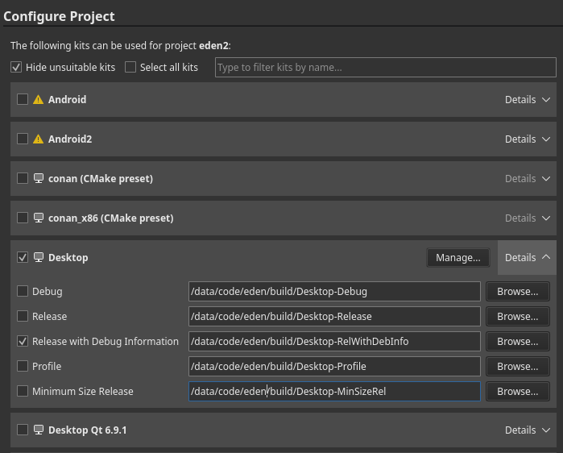

# Building Nemyu

> [!WARNING]
> This guide is intended for developers ONLY. If you are not a developer or packager, you are unlikely to receive support.

This is a full-fledged guide to build Nemyu on all supported platforms.

## Quick build

Two scripts set up the toolchain the release CI uses, then configure, build and package. They
install CMake 3.31.6, Ninja 1.13.2 and aqtinstall 3.3.0 into `.cache`, and only reconfigure when
the options or the commit changed.

Windows (PowerShell, x64, Visual Studio 2022 with "Desktop development with C++", Git for
Windows and Python 3). Qt 6.10.2 goes into `.cache\qt-msvc`; the Vulkan SDK 1.4.341.1 is used
from `C:\VulkanSDK`, and installing it once needs an elevated PowerShell:

```powershell
.\tools\windows\build.ps1 -Setup                     # check or install the toolchain
.\tools\windows\build.ps1                            # configure when needed, build nemyu and nemyu-cli into build\bin
.\tools\windows\build.ps1 -BuildType RelWithDebInfo -BuildDir build-dbg -Sccache
.\tools\windows\build.ps1 -Build -Package            # zip into build\release, without PDBs or the user folder
.\tools\windows\build.ps1 -Package -AllowDirty       # also zip a build of uncommitted changes, named "-dirty"
.\tools\windows\build.ps1 -Help
```

A build directory configured by another CMake (for example one from WinGet) is not reconfigured in
place: pass `-Fresh` to reconfigure it with the pinned CMake, or use another `-BuildDir`.

Linux (Debian/Ubuntu, Fedora, Arch or openSUSE; POSIX `sh`), building into `build-linux`:

```sh
sh tools/linux/build.sh --setup                  # list missing packages and print the install command
sh tools/linux/build.sh --setup --install-deps   # install them with sudo
sh tools/linux/build.sh --setup --aqt-qt         # use Qt 6.8.3 from aqtinstall when the distribution's is older than 6.5
sh tools/linux/build.sh                          # configure when needed, build nemyu and nemyu-cli
sh tools/linux/build.sh --build --package        # validated AppImage in out/linux-x86_64
sh tools/linux/build.sh --help
```

Both default to one job per 2 GB of memory (Windows counts the installed RAM, Linux the available
memory), at most one per thread; `-Jobs`/`--jobs` overrides it. Packaging refuses a build that is
not up to date or not configured at HEAD. See [Linux builds](../tools/linux/README.md#local-builds)
for more Linux options.

## Manual build

If you already have a development environment set up:

```sh
cmake -S . -B build -DCMAKE_BUILD_TYPE=Release -G Ninja
cmake --build build
```

On Linux, macOS, and MinGW/MSYS2, make sure to read the [dependencies guide](Deps.md). On Android, read its [dedicated page](build/Android.md).

## Dependencies

First, you must [install some dependencies](Deps.md).

## Clone

Next, you will want to clone Nemyu via the terminal:

```sh
git clone https://gitlab.com/nemyu-emulator/nemyu.git
cd nemyu
```

Or use Qt Creator (Create Project -> Import Project -> Git Clone).

## Android

Android has a completely different build process than other platforms. See its [dedicated page](build/Android.md).

## Initial Configuration

If the configure phase fails, see the `Troubleshooting` section below. Usually, as long as you followed the dependencies guide, the defaults *should* successfully configure and build.

### Option A: Qt Creator

This is the recommended GUI method for Linux, macOS, and Windows.

<details>
<summary>Click to Open</summary>

> [!WARNING]
> On MSYS2, to use Qt Creator you are recommended to *also* install Qt from the online installer, ensuring to select the "MinGW" version.

Open the CMakeLists.txt file in your cloned directory via File -> Open File or Project (Ctrl+O), if you didn't clone Nemyu via the project import tool.

Select your desired "kit" (usually, the default is okay). RelWithDebInfo or Release is recommended:



Hit "Configure Project", then wait for CMake to finish configuring (may take a while on Windows).

</details>

### Option B: Command Line

<details>
<summary>Click to Open</summary>

> [!WARNING]
>For all systems:
>
>- *CMake* **MUST** be in your PATH (and also *ninja*, if you are using it as `<GENERATOR>`)
>- You *MUST* be in the cloned *Nemyu* directory
>
>On Windows:
>
> - It's recommended to install **[Ninja](https://ninja-build.org/)**
> - You must load **Visual C++ development environment**, this can be done by running our convenience script:
>   - `tools/windows/load-msvc-env.ps1` (for PowerShell 5+)
>   - `tools/windows/load-msvc-env.sh` (for MSYS2, Git Bash, etc)

Available `<GENERATOR>`:

- MSYS2: `MSYS Makefiles`
- MSVC: `Ninja` (preferred) or `Visual Studio 17 2022`
- macOS: `Ninja` (preferred) or `Xcode`
- Others: `Ninja` (preferred) or `UNIX Makefiles`

Available `<BUILD_TYPE>`:

- `Release` (default)
- `RelWithDebInfo` (debug symbols--compiled executable will be large)
- `Debug` (if you are using a debugger and annoyed with stuff getting optimized out)

Caveat for Debug Builds:

- If you're building with CCache, you will need to add the environment variable `CL` with the `/FS` flag ([Reference](https://learn.microsoft.com/pt-br/cpp/build/reference/fs-force-synchronous-pdb-writes?view=msvc-170))

Also see the root CMakeLists.txt for more build options. Usually the default will provide the best experience, however.

```sh
cmake -S . -B build -G "<GENERATOR>" -DCMAKE_BUILD_TYPE=<BUILD_TYPE> -DYUZU_TESTS=OFF
```

If you are on Windows and prefer to use Clang:

```sh
cmake -S . -B build -G "<GENERATOR>" -DCMAKE_C_COMPILER=clang-cl -DCMAKE_CXX_COMPILER=clang-cl
```

</details>

### Option C: [CLion](https://www.jetbrains.com/clion/)

<details>
<summary>Click to Open</summary>

- Clone the Repository:


---

### Building & Setup

- Once Cloned, You will be taken to a prompt like the image below:


- Set the settings to the image below:
- Change `Build type: Release`
- Change `Name: Release`
- Change `Toolchain Visual Studio`
- Change `Generator: Let CMake decide`
- Change `Build directory: build`


- Click OK; now CLion will build a directory and index your code to allow for IntelliSense. Please be patient.
- Once this process has been completed (No loading bar bottom right), you can now build Nemyu
- In the top right, click on the drop-down menu, select all configurations, then select Nemyu


- Now run by clicking the play button or pressing Shift+F10, and Nemyu will auto-launch once built.


</details>

#### Option D: Visual Studio with clang-cl

<details>
1. Install `"x64 Native Tools Command Prompt"` for VS from the installer and also install `cmake-gui`.
2. Open `"x64 Native Tools Command Prompt"` and type `cmake-gui`.
3. Click configure choose ninja generator > specify native compilers.
4. Put `"C:/Program Files/Microsoft Visual Studio/18/Community/VC/Tools/Llvm/x64/bin/clang-cl.exe"` as your C/C++ compiler path.
5. Open `Visual studio > Open project` or Solution > Change to search for the CMake project file (`CMakeList.txt`) file on the cloned directory, and then build.
</details>

## Troubleshooting

If your initial configure failed:

- *Carefully* re-read the [dependencies guide](Deps.md)
- Clear the CPM cache (`.cache/cpm`) and CMake cache (`<build directory>/CMakeCache.txt`)
- Evaluate the error and find any related settings
- See the [CPM docs](CPMUtil.md) to see if you may need to forcefully bundle any packages

If it still fails, open an [issue on GitLab](https://gitlab.com/nemyu-emulator/nemyu/-/issues) and include the full configure output.

## Caveats

Many platforms have quirks, bugs, and other fun stuff that may cause issues when building OR running. See the [Caveats page](Caveats.md) before continuing.

## Building & Running

### On Qt Creator

Simply hit Ctrl+B, or the "hammer" icon in the bottom left. To run, hit the "play" icon, or Ctrl+R.

### On Command Line

If you are using the `UNIX Makefiles` or `Visual Studio 17 2022` as `<GENERATOR>`, you should also add `--parallel` for faster build times.

```sh
cmake --build build
```

Your compiled executable will be in:

- `build/bin/nemyu.exe` for Windows,
- `build/bin/nemyu.app/Contents/MacOS/nemyu` for macOS,
- and `build/bin/nemyu` for others.

## Scripts

On Windows, `.\tools\windows\build.ps1` does all of the above with MSVC: it finds or installs the toolchain the release CI uses (CMake, Ninja and Qt go into `.cache`), configures `build` and builds the GUI and CLI. `-Package` zips the result; `-Help` lists the options (build type, directory, targets, jobs, LTO, sccache, tests, extra CMake arguments).

Otherwise, run `.\tools\windows\load-msvc-env.ps1` (PowerShell) or source `. tools/windows/load-msvc-env.sh` (Git Bash, MSYS2) in the terminal you configure from; this loads the Visual C++ environment. The Windows release zip is made from a build in `build` by `tools/windows/publish-gitlab-release.ps1`, which packages the build but does not build anything.

### Tuned Windows builds (LTCG, ThinLTO, PGO)

`.\tools\windows\build-pgo.ps1 -Mode <mode>` makes an optional build tuned for speed in its own directory (`build-<mode>`), through `build.ps1` and `tools/windows/tuned-build.cmake`. The release, `build.ps1` and a plain CMake configure are unchanged. Every mode targets x86-64-v3 by default (AVX2: Haswell, Ryzen or newer); `-Arch generic` drops that.

| Mode | Compiler | What it adds |
| --- | --- | --- |
| `msvc-ltcg` | MSVC | `/GL` + `/LTCG` (`ENABLE_LTO`) and `/arch:AVX2` |
| `clang-lto` | clang-cl | ThinLTO with lld-link and `-march=x86-64-v3` |
| `clang-pgo-generate` | clang-cl | An instrumented build that records a profile while it runs (2-3x slower; for training only) |
| `merge` | | Merges the recorded profiles into `.cache\pgo\nemyu.profdata` with `llvm-profdata` |
| `clang-pgo-use` | clang-cl | ThinLTO, `-march=x86-64-v3` and `-fprofile-use` with the merged profile |

The clang-cl modes need LLVM for Windows with `clang-cl`, `lld-link`, `llvm-lib`, `llvm-profdata` and compiler-rt's `clang_rt.profile` library, all of which the official installer has. The script looks in `-LlvmRoot`, `LLVM_ROOT`, `C:\Program Files\LLVM`, `C:\LLVM` and Visual Studio's "C++ Clang tools for Windows" component. Use the same LLVM for every step: raw profiles only merge with the `llvm-profdata` of the LLVM that wrote them, and an older compiler can't read a newer profile. The first clang-cl configure also downloads the `llvm-mingw` compiler builtins (`cpmfile.json`).

Profile-guided optimization takes three steps:

1. `.\tools\windows\build-pgo.ps1 -Mode clang-pgo-generate`
2. Train: run `build-clang-pgo-generate\bin\nemyu-cli.exe` (or `nemyu.exe`) with `LLVM_PROFILE_FILE` naming a file in `.cache\pgo\raw`, with `%p` in it so runs don't overwrite each other. The profile is written at exit and every 30 seconds. For example, the Mario Kart World race benchmark (instrumented runs are slow, so give them more time):

   ```powershell
   .\tools\nx2\mkw_bench\bench.ps1 -Tag pgo-mkw -Exe build-clang-pgo-generate\bin\nemyu-cli.exe -Game <dump>\exefs\main `
       -Config <config>.ini -Seconds 900 -QuitAtFrame 6000 `
       -EnvPairs "EDEN_NX2_MKW_FPS_MODE=dynamic;LLVM_PROFILE_FILE=$PWD\.cache\pgo\raw\mkw-%p.profraw"
   ```

   Code no training run reaches is optimized for size, as if it were rarely used, so train on every kind of game the build should stay fast for: besides Mario Kart World, at least Donkey Kong Bananza, Ocarina of Time docked, Pokopia and a Switch 1 title, a few minutes each.
3. `.\tools\windows\build-pgo.ps1 -Mode merge`, then `.\tools\windows\build-pgo.ps1 -Mode clang-pgo-use`.

The profile is keyed by function, so one recorded with `nemyu-cli` also applies to `nemyu.exe`. Functions changed after the training build get no profile, so retrain when the GPU or core code has changed much. Compare a tuned build with a regular one on the same commit, frame times and captures both, before relying on it.

For other setups, write your own configure script based on the commands above. It is not hard, provided you can read CMake.
